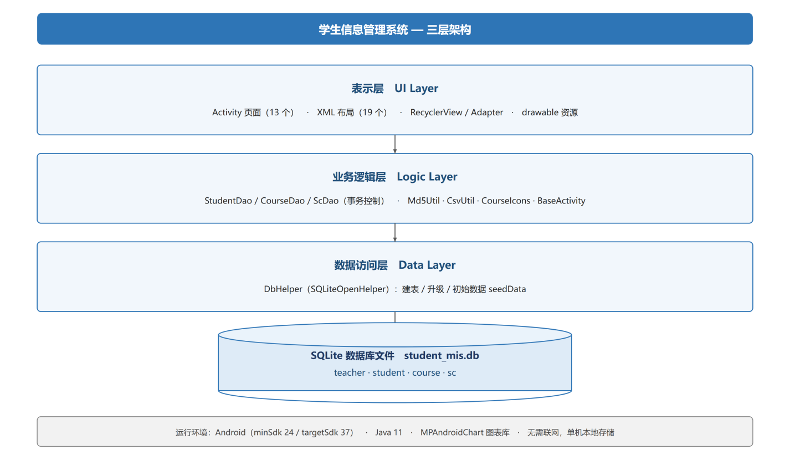
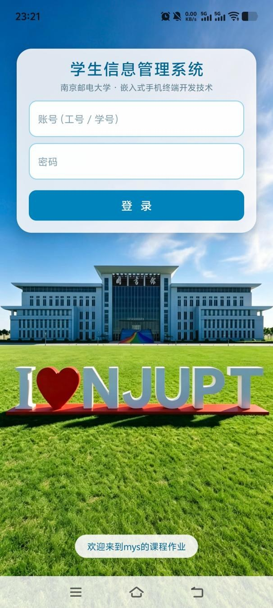
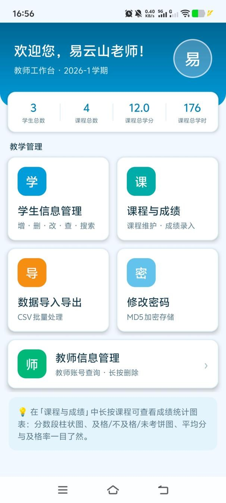
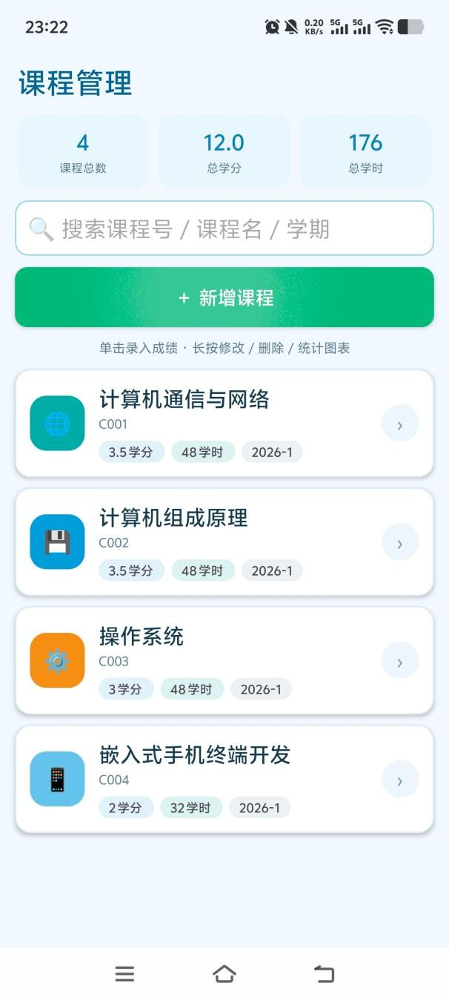
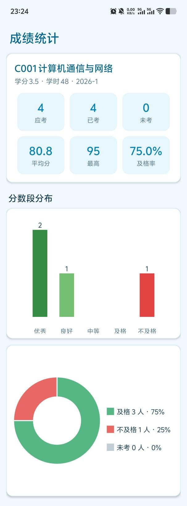
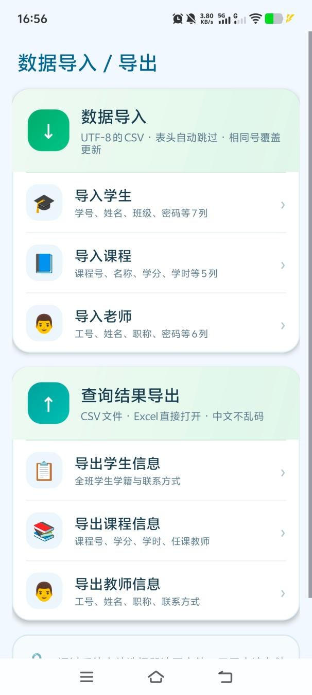
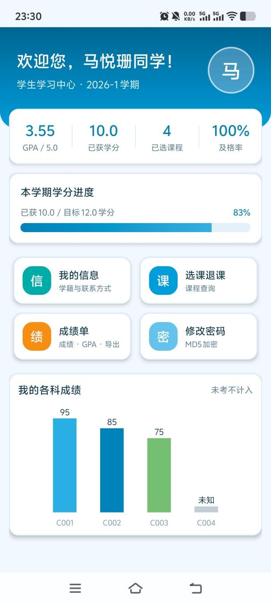
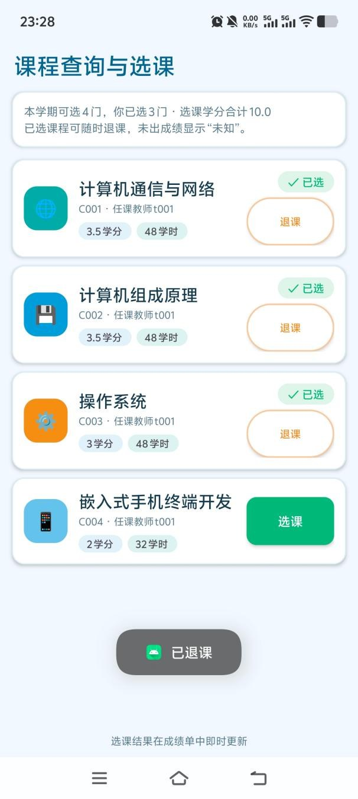
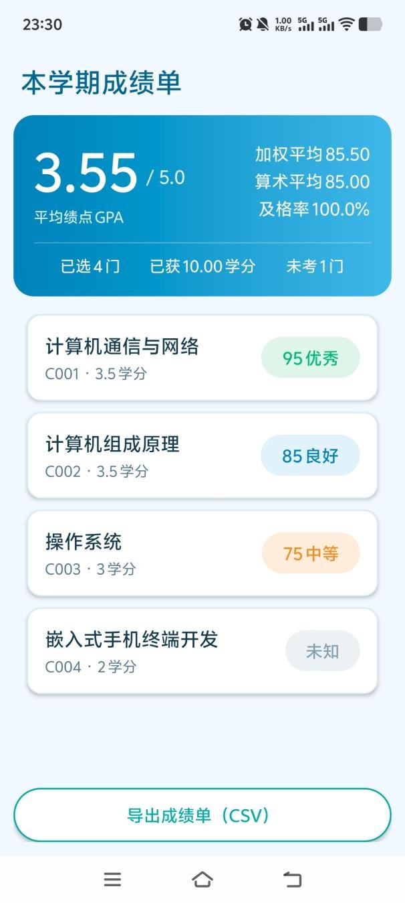

# 学生信息管理系统（Android）

南京邮电大学《嵌入式手机终端开发技术》课程设计——基于 Android 原生开发的双角色学生信息管理系统，覆盖学生、教师、课程、选课与成绩的完整管理闭环，数据本地存储于 SQLite，无需联网即可使用。

## 功能特性

**教师端**

- 学生信息管理：学生信息的新增、编辑、删除、搜索与列表展示
- 课程与成绩：课程信息维护、按课程录入成绩、成绩分段柱状图与及格率饼图统计（MPAndroidChart）
- 数据导入导出：支持 UTF-8 编码的 CSV 批量导入学生 / 课程 / 教师，导出 CSV 用 Excel 直接打开不乱码
- 教师信息管理、登录密码修改（MD5 加密存储）

**学生端**

- 个人信息查看与维护
- 课程查询、在线选课与退课（同课程互斥、已选 / 未选状态实时刷新）
- 本学期成绩单：加权平均分、平均绩点（GPA）、及格率、学分进度与成绩分布图
- 成绩单 CSV 导出、登录密码修改

## 技术架构

采用 UI 展示层—业务逻辑层—数据层的三层结构：



- **UI 层**：Activity + XML 布局，列表统一使用 RecyclerView + Adapter
- **逻辑层**：DAO（Data Access Object）封装学生、教师、课程、选课的全部业务操作
- **数据层**：SQLiteOpenHelper 建库，包含 teacher、student、course、sc（选课成绩）四张表，表间通过工号 / 学号 / 课程号关联
- 密码使用 MD5 摘要存储；CSV 读写统一处理 UTF-8 BOM

## 运行截图

教师端：

    

学生端：

  

## 运行方式

**方式一：Android Studio 运行源码**

1. 用较新版本的 Android Studio 打开本项目根目录（工程基于 Gradle 9.6.0、AGP 9.4.1，JDK 由 Foojay Toolchain 自动解析，无需手动安装）
2. 等待 Gradle Sync 完成
3. 连接手机（开启 USB 调试）或启动模拟器，点击 Run

工程配置了两个产品风味（Flavor）：`standard` 为正式包，`preview` 为可与正式版共存的适配预览版（包名追加 `.preview`）。

**方式二：直接安装 APK**

`apk/app-standard-debug.apk` 为已编译的调试包，支持 Android 7.0（API 24）及以上系统，传到手机直接安装即可。

## 演示账号

| 角色 | 账号 | 密码 |
| --- | --- | --- |
| 教师 | t001 | 123456 |
| 学生 | B24040201 | 123456 |

首次启动时应用会自动创建数据库并写入演示数据（教师 1 名、学生 3 名、课程 4 门及对应的选课成绩记录）。

## 项目结构

```
app/src/main/
├── java/com/example/studentmanagersystem/
│   ├── db/DbHelper.java          # SQLite 建库、建表与演示数据
│   ├── StudentDao / TeacherDao / CourseDao / ScDao.java   # 数据访问层
│   ├── *Activity.java            # 教师端、学生端各页面
│   ├── *Adapter.java             # RecyclerView 列表适配器
│   ├── CsvUtil.java              # CSV 导入导出
│   └── Md5Util.java              # 密码 MD5 加密
├── res/                          # 布局、Drawable、图标等资源
└── AndroidManifest.xml
```

## 技术栈

Java · AndroidX · Material Components · RecyclerView · SQLite · MPAndroidChart 3.1.0 · CSV（UTF-8 BOM）· MD5

---

南京邮电大学 计算机学院 ·《嵌入式手机终端开发技术》课程设计 · 2026 年
